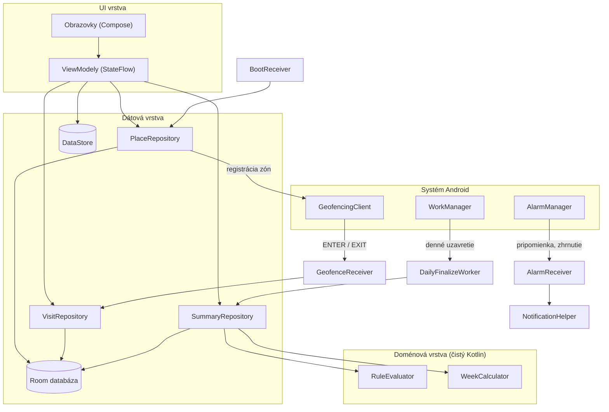
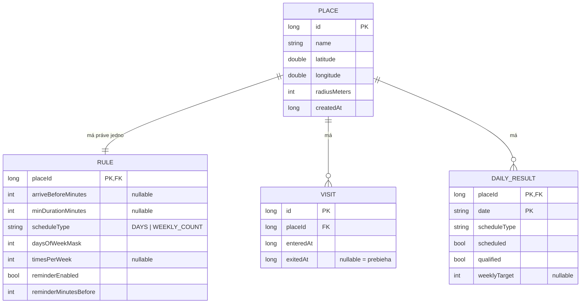
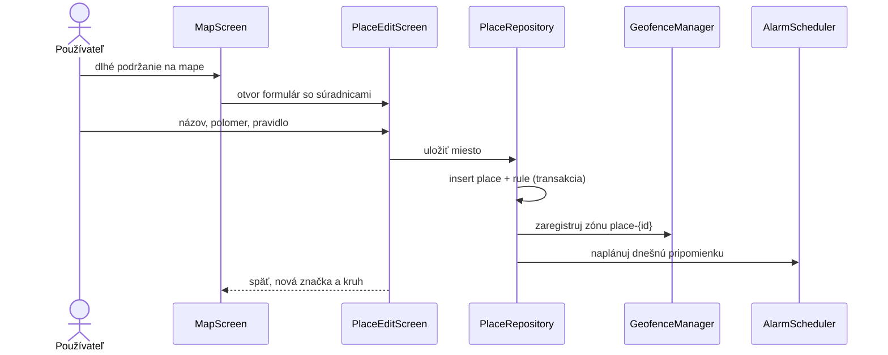
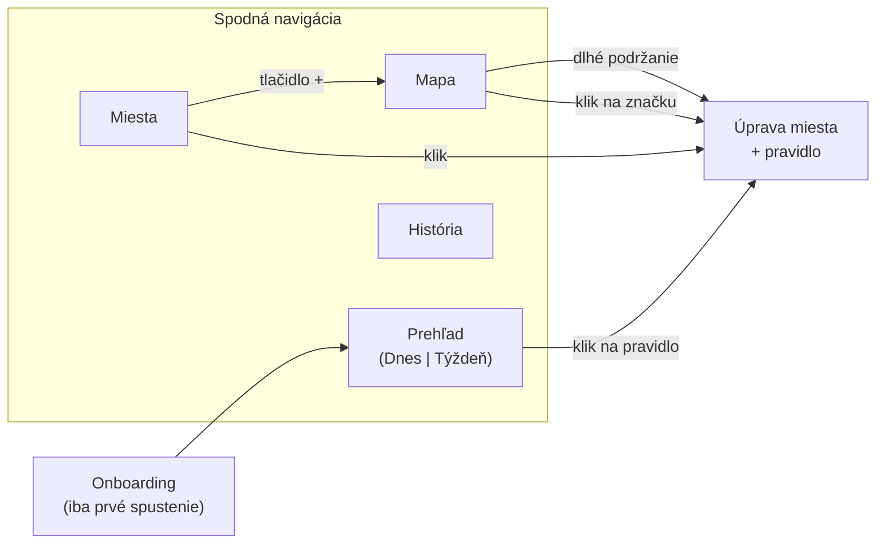

# Routine Maker – Návrh riešenia

Vychádza zo [SPEC.md](SPEC.md). Odkazy v tvare **1.1** sú funkcie, **R1** rozhodnuté otázky a **K1.1-a** akceptačné kritériá zo špecifikácie. Dokument zatiaľ neobsahuje kód. Popisuje dátový model, rozhrania medzi vrstvami a štruktúru aplikácie.

---

## 1. Architektúra

Aplikácia má **jednu aktivitu** (Jetpack Compose) a architektúru **MVVM** s tromi vrstvami:



**Rozhodnutia:**
- **Doménová logika je čistý Kotlin** bez závislostí na Androide. Vyhodnotenie pravidiel (R5 – R9) sa dá otestovať obyčajnými unit testami.
- **Manuálna dependency injection** cez jednu triedu `AppContainer`, ktorá vznikne v `Application`. Hilt by pri tejto veľkosti projektu pridal zbytočnú zložitosť.
- **Žiadny server:** všetky dáta sú v Room databáze, nastavenia v DataStore.
- **Dnešný deň sa počíta naživo** z návštev a pravidiel. **Uzavreté dni sa ukladajú** ako snímka do tabuľky `daily_result`, aby ich nezmenila neskoršia úprava pravidla (R10).

## 2. Štruktúra projektu

```
app/src/main/java/sk/routinemaker/
├── RoutineMakerApp.kt          Application, vytvára AppContainer
├── AppContainer.kt             manuálna DI: databáza, repozitáre, helpery
├── MainActivity.kt             jediná aktivita, hostí navigáciu
│
├── data/
│   ├── db/                     AppDatabase, entity, DAO, konvertory
│   ├── repository/             PlaceRepository, VisitRepository, SummaryRepository
│   └── prefs/                  SettingsStore (DataStore)
│
├── domain/                     RuleEvaluator, WeekCalculator, doménové modely
│
├── location/                   GeofenceManager, GeofenceReceiver, LocationStatus
├── scheduling/                 AlarmScheduler, AlarmReceiver, DailyFinalizeWorker
├── notifications/              NotificationHelper, notifikačné kanály
├── system/                     BootReceiver, PermissionChecker
│
└── ui/
    ├── navigation/             NavGraph, cieľové obrazovky
    ├── theme/                  Material 3 téma
    ├── components/             spoločné prvky (PermissionBanner, StatusChip …)
    ├── onboarding/
    ├── overview/               Dnes + Týždeň
    ├── map/
    ├── places/                 zoznam + detail / úprava miesta a pravidla
    └── history/
```

Každá obrazovka v `ui/` má vlastný `…Screen` (Compose) a `…ViewModel`.

## 3. Dátový model

### 3.1 Prehľad



Všetky cudzie kľúče majú `ON DELETE CASCADE`. Zmazanie miesta tak zmaže aj pravidlo, návštevy a výsledky (R15).

### 3.2 Tabuľky

**`place`:** miesto na mape (1.1 – 1.4)

| Stĺpec | Typ | Poznámka |
|---|---|---|
| `id` | Long, PK, autoincrement | Používa sa aj ako ID zóny (`place-{id}`) a request code alarmu. |
| `name` | String | Neprázdny (K1.1-b). |
| `latitude`, `longitude` | Double | Stred zóny. |
| `radiusMeters` | Int | 100 – 500, predvolene 150 (R13). |
| `createdAt` | Long | Epoch millis. |

**`rule`:** pravidlo miesta, vzťah 1 : 1 (2.1 – 2.3, 5.2)

| Stĺpec | Typ | Poznámka |
|---|---|---|
| `placeId` | Long, PK, FK → place | |
| `arriveBeforeMinutes` | Int? | Minúty od polnoci, napr. 8:00 = 480. `null` znamená bez času (R4). |
| `minDurationMinutes` | Int? | 5 – 600. `null` znamená bez minimálnej dĺžky (R4). |
| `scheduleType` | Enum | `DAYS` (plán A) alebo `WEEKLY_COUNT` (plán B) (R6). |
| `daysOfWeekMask` | Int | Bitová maska, Po = bit 0 … Ne = bit 6. Pri pláne A musí byť nenulová. |
| `timesPerWeek` | Int? | 1 – 7, iba pri pláne B. |
| `reminderEnabled` | Boolean | Predvolene `true`. |
| `reminderMinutesBefore` | Int | 5 – 120, predvolene 30 (R11). |

**`visit`:** zaznamenaná návšteva (3.1, 3.3)

| Stĺpec | Typ | Poznámka |
|---|---|---|
| `id` | Long, PK | |
| `placeId` | Long, FK → place, index | |
| `enteredAt` | Long | Epoch millis. Index pre dotazy podľa dňa. |
| `exitedAt` | Long? | `null` znamená, že návšteva práve prebieha. Pre každé miesto môže byť otvorená najviac jedna. |

**`daily_result`:** snímka uzavretého dňa (4.1, 4.2, R10)

| Stĺpec | Typ | Poznámka |
|---|---|---|
| `placeId` + `date` | zložený PK | `date` vo formáte ISO `2026-10-20`. |
| `scheduleType` | Enum | Kópia z pravidla v ten deň. |
| `scheduled` | Boolean | Plán A: bol to vybraný deň. Plán B: vždy `false`. |
| `qualified` | Boolean | V ten deň existovala platná návšteva (R5, R7). |
| `weeklyTarget` | Int? | Kópia `timesPerWeek` (plán B), aby sa minulé týždne dali vyhodnotiť aj po zmene pravidla. |

### 3.3 DataStore (nastavenia)

| Kľúč | Typ | Účel |
|---|---|---|
| `onboardingCompleted` | Boolean | Onboarding iba pri prvom spustení (K6.1-a). |
| `lastFinalizedDate` | String? | Posledný uzavretý deň, slúži na dobehnutie vynechaných dní. |

### 3.4 Práca s časom

- Okamihy (`enteredAt`, `exitedAt`) sa ukladajú ako **epoch millis** (UTC).
- Dni a časy sa počítajú cez `java.time` v **časovej zóne telefónu** (`ZoneId.systemDefault()`).
- Začiatok týždňa je **pondelok** (R9).

## 4. Rozhrania vrstiev

Popisujú, čo ktorá časť poskytuje. Konkrétne signatúry vzniknú pri implementácii.

### 4.1 Repozitáre

**PlaceRepository**

| Operácia | Vstup | Výstup | Vedľajšie účinky |
|---|---|---|---|
| sledovať miesta | – | prúd zoznamu miest s pravidlami | – |
| načítať miesto | id | miesto s pravidlom | – |
| uložiť miesto | miesto + pravidlo | id | Zaregistruje alebo aktualizuje zónu, preplánuje dnešnú pripomienku. |
| zmazať miesto | id | – | Odregistruje zónu, zruší alarm, kaskádovo zmaže dáta. |
| znova zaregistrovať všetko | – | – | Odstráni a pridá všetky zóny (po reštarte, po udelení povolenia). |

**VisitRepository**

| Operácia | Vstup | Výstup | Poznámka |
|---|---|---|---|
| spracovať vstup | placeId, čas | – | Logika R2, pozri 5.2. |
| spracovať odchod | placeId, čas | – | Logika R1, pozri 5.2. |
| sledovať návštevy | rozsah dní | prúd návštev | Pre históriu (3.3). |
| je používateľ na mieste | placeId | áno / nie | Pre pripomienky (R11). |
| uzavrieť zabudnuté návštevy | deň | – | Otvorené návštevy z uzatváraného dňa (O2). |

**SummaryRepository**

| Operácia | Vstup | Výstup | Poznámka |
|---|---|---|---|
| sledovať dnešok | – | prúd stavov pravidiel na dnes | Počíta sa naživo (4.1). |
| sledovať týždeň | pondelok týždňa | úspešnosť za miesta a celkovo | Uzavreté dni z `daily_result`, dnešok naživo (4.2). |
| uzavrieť dni | do dátumu (vrátane) | – | Uloží snímky do `daily_result` pre všetky neuzavreté dni. |

### 4.2 Doména

**RuleEvaluator:** vyhodnotenie jedného pravidla v jeden deň.
- Vstup: pravidlo, deň, návštevy daného miesta v ten deň, aktuálny čas.
- Výstup: stav `SPLNENÉ` / `ČAKÁ` / `NESPLNENÉ` / `NENAPLÁNOVANÉ` a príznak `qualified`.
- Algoritmus je v kapitole 6.

**WeekCalculator:** týždenná úspešnosť.
- Vstup: výsledky dní týždňa pre každé miesto (uzavreté aj dnešný).
- Výstup: pre každé miesto `splnené / požadované` a percento, plus celkové percento (R9).

## 5. Kľúčové toky

### 5.1 Pridanie miesta (1.1, 1.2, 2.x)



### 5.2 Vstup do zóny a odchod zo zóny (3.1, R1, R2)

Zóna sa registruje s prechodmi `ENTER | EXIT`, `initialTrigger = ENTER` (ak je používateľ v zóne už pri registrácii) a bez expirácie.

`GeofenceReceiver` dostane udalosť a cez `goAsync()` ju v korutine predá `VisitRepository`:

**Vstup (ENTER):**
1. Ak má miesto otvorenú návštevu, udalosť sa ignoruje (duplicitná udalosť).
2. Ak posledná návšteva miesta skončila pred menej ako **10 minútami**, znova sa otvorí, teda `exitedAt = null` (R2).
3. Inak sa vytvorí nová návšteva s `enteredAt = čas udalosti`.

**Odchod (EXIT):**
1. Ak miesto nemá otvorenú návštevu, udalosť sa ignoruje.
2. Nastaví sa `exitedAt = čas udalosti`.
3. Ak návšteva trvala menej ako **5 minút**, zmaže sa (R1).

Ako čas udalosti sa použije čas polohy z udalosti, nie čas spracovania. Oneskorené doručenie tak neskreslí dĺžku pobytu.

### 5.3 Reštart telefónu a aktualizácia aplikácie (3.2)

`BootReceiver` počúva na `BOOT_COMPLETED` a `MY_PACKAGE_REPLACED`. Po reštarte systém zóny aj alarmy zabudne, preto receiver:
1. znova zaregistruje všetky zóny,
2. znova naplánuje dnešné pripomienky a denné zhrnutie,
3. naplánuje uzavretie dní (dobehne vynechané).

### 5.4 Denné uzavretie (4.1, 4.2, R10, O2)

`DailyFinalizeWorker` (periodický WorkManager, raz denne, krátko po polnoci) a aj každé spustenie aplikácie:
1. Zistí `lastFinalizedDate` a pre každý deň od nasledujúceho po **včerajšok**:
   1. uzavrie otvorené návštevy z toho dňa o 23:59 (O2),
   2. pre každé miesto zavolá `RuleEvaluator` a uloží riadok do `daily_result`.
2. Uloží nový `lastFinalizedDate`.
3. Naplánuje pripomienky na dnešok.

Vďaka dobiehaniu nevadí, ak sa worker oneskorí alebo bol telefón vypnutý.

### 5.5 Pripomienka (5.1, 5.2, R11)

1. `AlarmScheduler` pre každé miesto, kde je pripomienka relevantná, nastaví alarm na `arriveBefore − reminderMinutesBefore` (iba ak ten čas dnes ešte neuplynul).
2. Alarm sa nastavuje cez `AlarmManager.setAndAllowWhileIdle`. Funguje aj v úspornom režime a nepotrebuje povolenie na presné alarmy. Odchýlka do 15 minút je v súlade so špecifikáciou.
3. `AlarmReceiver` pri spustení **znova overí** podmienky R11 (používateľ mohol medzitým prísť) a až potom zobrazí notifikáciu.

Pripomienky sa preplánujú pri uložení alebo zmazaní miesta, pri dennom uzavretí, po reštarte a pri spustení aplikácie.

### 5.6 Denné zhrnutie (4.3, R12)

Alarm na 21:00 (rovnaký mechanizmus ako 5.5). `AlarmReceiver` vypočíta dnešné stavy cez `SummaryRepository`, zobrazí notifikáciu „Dnes X z Y ✓“ a naplánuje alarm na ďalší deň.

## 6. Algoritmus vyhodnotenia dňa (RuleEvaluator)

Vstup: pravidlo, deň `D`, návštevy miesta začínajúce v deň `D` (R3), aktuálny čas `now`.

1. **Je deň relevantný?** Pri pláne A, ak `D` nie je vo `daysOfWeekMask` → `NENAPLÁNOVANÉ` (návštevy sa aj tak vyhodnotia pre `qualified`, ale do úspešnosti sa nerátajú).
2. **Platná návšteva:** návšteva je platná, ak
   - `arriveBeforeMinutes` je `null` **alebo** čas príchodu ≤ `arriveBeforeMinutes`, **a zároveň**
   - `minDurationMinutes` je `null` **alebo** (`exitedAt` alebo `now`, ak návšteva prebieha) − `enteredAt` ≥ `minDurationMinutes`.
3. Ak existuje aspoň jedna platná návšteva → `qualified = true`, stav `SPLNENÉ` (R7: ráta sa iba jedna).
4. Inak, ak sa to ešte dá stihnúť → `ČAKÁ`. To platí, ak:
   - prebieha návšteva, ktorá splnila podmienku času príchodu a dobieha jej iba dĺžka, **alebo**
   - `arriveBeforeMinutes` je nastavené a `now` je pred ním, **alebo**
   - `arriveBeforeMinutes` nie je nastavené a deň `D` ešte neskončil.
5. Inak → `NESPLNENÉ`.

Pri pláne B sa stav dňa v UI nahrádza priebehom týždňa „dni s `qualified` / cieľ“ (R8). Týždennú úspešnosť počíta `WeekCalculator` podľa R9.

Na tomto algoritme stoja akceptačné kritériá K4.1-a až K4.2-c, ktoré sa dajú priamo prepísať do unit testov.

## 7. Práca na pozadí

| Čo | Mechanizmus | Kedy | Prečo tento mechanizmus |
|---|---|---|---|
| Zaznamenávanie návštev | Geofencing API → `GeofenceReceiver` | Pri vstupe do zóny a odchode | Systém sleduje polohu úsporne, aplikácia nemusí bežať. |
| Uzavretie dní | WorkManager, periodicky 24 h | Krátko po polnoci a pri spustení aplikácie | Nezáleží na presnom čase, dôležité je, že sa to stane. |
| Pripomienky | AlarmManager (`setAndAllowWhileIdle`) | Pred časom príchodu | Viazané na konkrétny čas. |
| Denné zhrnutie | AlarmManager (`setAndAllowWhileIdle`) | 21:00 | Viazané na konkrétny čas. |
| Obnova po reštarte | `BootReceiver` | `BOOT_COMPLETED`, `MY_PACKAGE_REPLACED` | Systém po reštarte zabudne zóny aj alarmy. |

## 8. Notifikácie

| Kanál | Dôležitosť | Obsah | Kliknutie otvorí |
|---|---|---|---|
| `reminders` – „Pripomienky“ | vysoká | „Je 7:30 a ešte nie si v Gym (do 8:00)“ | detail miesta |
| `summaries` – „Zhrnutia“ | predvolená | „Dnes 2 z 3 ✓“ | obrazovku Dnes |

ID notifikácie pripomienky = `placeId`. Nová pripomienka pre to isté miesto tak nahradí starú.

## 9. Obrazovky a navigácia



| Obrazovka | Funkcie | Obsah |
|---|---|---|
| **Onboarding** | 6.1, 6.2 | 4 kroky: čo aplikácia robí → poloha → poloha na pozadí → notifikácie. Každý krok sa dá preskočiť. |
| **Prehľad – Dnes** | 4.1, 6.3 | Karty pravidiel so stavom (Splnené / Čaká / Nesplnené / Nenaplánované, pri pláne B „2 / 3“). Banner, ak chýba povolenie. |
| **Prehľad – Týždeň** | 4.2 | Pre každé miesto 7 bodiek Po – Ne a percento, hore celkové percento. Šípky na predchádzajúce týždne. |
| **Mapa** | 1.1, 1.2 | Značky a kruhy zón. Kamera sa nastaví na aktuálnu polohu, ak je povolená, inak na Slovensko. |
| **Miesta** | 1.3 | Zoznam s názvom a popisom pravidla (K1.3-a). |
| **Úprava miesta** | 1.2, 1.4, 2.1 – 2.3, 5.2 | Malá mapa s kruhom, názov, posuvník polomeru, čas príchodu, min. dĺžka, plán A/B, pripomienka, tlačidlo Zmazať. |
| **História** | 3.3 | Návštevy podľa dní, najnovšie hore. Prebiehajúca návšteva označená „práve tu“. |

## 10. Povolenia

| Povolenie | Na čo | Kedy sa žiada |
|---|---|---|
| `ACCESS_FINE_LOCATION`, `ACCESS_COARSE_LOCATION` | poloha, mapa | Onboarding, krok 2 |
| `ACCESS_BACKGROUND_LOCATION` | geofencing na pozadí | Onboarding, krok 3 – presmerovanie do nastavení (Android 11+) |
| `POST_NOTIFICATIONS` | pripomienky a zhrnutia | Onboarding, krok 4 (Android 13+) |
| `RECEIVE_BOOT_COMPLETED` | obnova po reštarte | Netreba žiadať, iba v manifeste |
| `INTERNET` | mapové podklady | Netreba žiadať, iba v manifeste |

`PermissionChecker` pri každom návrate do aplikácie (`ON_RESUME`) zistí stav povolení a či je zapnutá poloha telefónu. Ak niečo chýba, zobrazí sa `PermissionBanner` s tlačidlom do príslušných nastavení (K6.3-a). Keď sa povolenie objaví, zavolá sa „znova zaregistrovať všetko“ (K6.3-b).

## 11. Hraničné stavy

| Situácia | Správanie |
|---|---|
| Chýba poloha na pozadí | Zóny sa neregistrujú, zobrazí sa banner. Dni sa vyhodnocujú normálne, teda ako nesplnené (O1). |
| Dosiahnutý limit 100 miest | Tlačidlo na pridanie je neaktívne a zobrazí sa vysvetlenie (R14). |
| Registrácia zóny zlyhá (napr. vypnutá poloha) | Miesto sa uloží, chyba sa zaloguje. Opätovná registrácia prebehne po zapnutí polohy. |
| Úprava polohy alebo polomeru počas prebiehajúcej návštevy | Stará zóna sa odstráni, nová pridá s `initialTrigger = ENTER`. Ak používateľ v novej zóne nie je, otvorená návšteva sa uzavrie časom úpravy. |
| Zmena časovej zóny alebo letný čas | Všetko sa ukladá v UTC a deň sa určuje až pri vyhodnotení v aktuálnej zóne telefónu. |
| Bez internetu | Mapa nezobrazí podklady, ale všetko ostatné funguje. |

## 12. Konfigurácia a závislosti

| Položka | Hodnota |
|---|---|
| `minSdk` / `targetSdk` | 29 / aktuálne stabilné API |
| UI | Jetpack Compose, Material 3, Navigation Compose |
| Mapa | Maps Compose (Google Maps SDK) |
| Poloha | Play Services Location |
| Databáza | Room (+ KSP) |
| Nastavenia | DataStore Preferences |
| Pozadie | WorkManager, AlarmManager |
| Asynchrónnosť | Kotlin Coroutines, Flow |
| Testy | JUnit, Room in-memory databáza, Compose UI testy |

**API kľúč pre Google Maps** sa ukladá do `local.properties` (cez Secrets Gradle Plugin) a **necommituje sa** do repozitára.

## 13. Testovanie

| Úroveň | Čo sa testuje | Kritériá |
|---|---|---|
| Unit testy (JVM) | `RuleEvaluator`, `WeekCalculator`: tabuľka prípadov priamo z kritérií | K4.1-a – e, K4.2-a – c, K2.3-b |
| Unit testy s in-memory Room | `VisitRepository`: zlúčenie do 10 min, zahodenie pod 5 min, duplicitné udalosti | K3.1-c, K3.1-d |
| Unit testy s in-memory Room | `SummaryRepository`: uzavretie dní, dobehnutie vynechaných dní, zmena pravidla nemení históriu | K2.3-b, R10 |
| Manuálne v emulátore | Simulovaná poloha a trasy (GPX), reštart emulátora, odmietnutie povolení | K3.1-a, b, e, K3.2-a, K5.x, K6.x |
| Manuálne na telefóne | Reálne použitie počas niekoľkých dní | celkové overenie |

## 14. Poradie implementácie

Implementuje sa po funkciách. Každý krok končí funkčnou aplikáciou, ktorá sa overí podľa príslušných kritérií.

1. **Kostra:** projekt, téma, navigácia, `AppContainer`, Room databáza s entitami.
2. **Miesta (1.1 – 1.4):** mapa, pridanie, zoznam, úprava, zmazanie.
3. **Pravidlá (2.1 – 2.3):** formulár pravidla v úprave miesta.
4. **Povolenia (6.1 – 6.3):** onboarding, `PermissionChecker`, banner.
5. **Zaznamenávanie (3.1 – 3.3):** geofencing, `VisitRepository`, `BootReceiver`, história.
6. **Vyhodnotenie (4.1, 4.2):** `RuleEvaluator`, `WeekCalculator` s unit testami, obrazovky Dnes a Týždeň, `DailyFinalizeWorker`.
7. **Notifikácie (4.3, 5.1, 5.2):** kanály, `AlarmScheduler`, pripomienky, denné zhrnutie.
